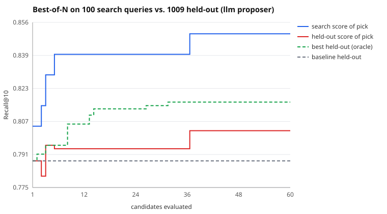

# Search run: llm proposer, 60 candidates

Search split: 100 queries. Held out: 1009 queries the search never saw. Seed 7.

| | search split | held out |
|---|---|---|
| Baseline BM25 | 0.8050 | 0.7881 |
| Picked (best on search) | 0.8500 | 0.8028 |
| Oracle (best on held-out) | 0.8300 | 0.8167 |

- **Claimed gain** (search split): +4.5 pts Recall@10
- **Real gain** (held out): +1.5 pts (95% CI -0.0 pts to +2.9 pts)
- **Gain inflation** (claimed minus real): +3.0 pts
- Optimism of the pick (its search score minus its held-out score): +4.7 pts
- Rank correlation of search vs held-out scores across candidates: 0.69
- Picked config: `{"b": 0.76, "k1": 0.2, "prf_docs": 1, "prf_terms": 2, "prf_weight": 0.2, "stem": true, "stopwords": true, "title_weight": 0.85}`

LLM proposer (qwen3:4b via LLMGate): 59 proposals, 59 gateway calls, 70,080 tokens (1188/proposal), 4 unparseable replies, 0 gateway errors, 6.9s mean latency.

