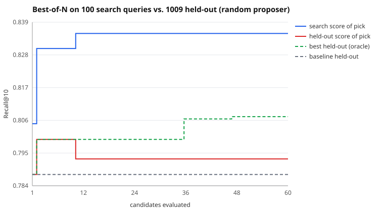

# Search run: random proposer, 60 candidates

Search split: 100 queries. Held out: 1009 queries the search never saw. Seed 7.

| | search split | held out |
|---|---|---|
| Baseline BM25 | 0.8050 | 0.7881 |
| Picked (best on search) | 0.8350 | 0.7933 |
| Oracle (best on held-out) | 0.8300 | 0.8074 |

- **Claimed gain** (search split): +3.0 pts Recall@10
- **Real gain** (held out): +0.5 pts (95% CI -0.8 pts to +1.8 pts)
- **Gain inflation** (claimed minus real): +2.5 pts
- Optimism of the pick (its search score minus its held-out score): +4.2 pts
- Rank correlation of search vs held-out scores across candidates: 0.84
- Picked config: `{"b": 0.63, "k1": 0.88, "prf_docs": 5, "prf_terms": 18, "prf_weight": 0.12, "stem": true, "stopwords": true, "title_weight": 0.27}`

