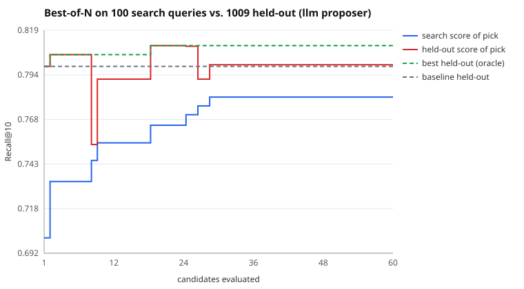

# Search run: llm proposer, 60 candidates

Search split: 100 queries. Held out: 1009 queries the search never saw. Seed 11.

| | search split | held out |
|---|---|---|
| Baseline BM25 | 0.7010 | 0.7984 |
| Picked (best on search) | 0.7810 | 0.7994 |
| Oracle (best on held-out) | 0.7650 | 0.8102 |

- **Claimed gain** (search split): +8.0 pts Recall@10
- **Real gain** (held out): +0.1 pts (95% CI -1.5 pts to +1.7 pts)
- **Gain inflation** (claimed minus real): +7.9 pts
- Optimism of the pick (its search score minus its held-out score): -1.8 pts
- Rank correlation of search vs held-out scores across candidates: 0.43
- Picked config: `{"b": 0.3, "k1": 1.08, "prf_docs": 1, "prf_terms": 9, "prf_weight": 0.28, "stem": false, "stopwords": true, "title_weight": 0.16}`

LLM proposer (qwen3:4b via LLMGate): 59 proposals, 59 gateway calls, 76,391 tokens (1295/proposal), 0 unparseable replies, 0 gateway errors, 6.3s mean latency.

