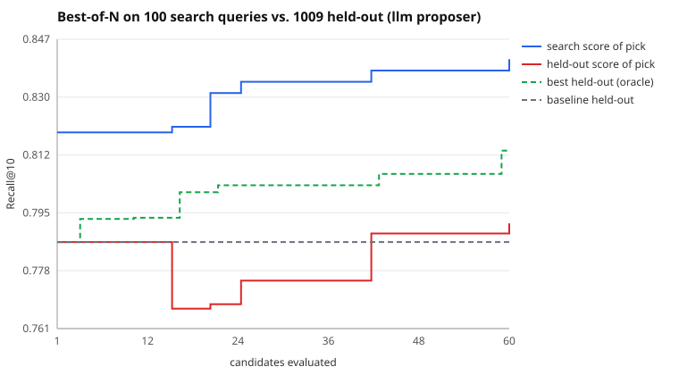

# Search run: llm proposer, 60 candidates

Search split: 100 queries. Held out: 1009 queries the search never saw. Seed 13.

| | search split | held out |
|---|---|---|
| Baseline BM25 | 0.8192 | 0.7867 |
| Picked (best on search) | 0.8408 | 0.7923 |
| Oracle (best on held-out) | 0.8175 | 0.8138 |

- **Claimed gain** (search split): +2.2 pts Recall@10
- **Real gain** (held out): +0.6 pts (95% CI -1.0 pts to +2.0 pts)
- **Gain inflation** (claimed minus real): +1.6 pts
- Optimism of the pick (its search score minus its held-out score): +4.9 pts
- Rank correlation of search vs held-out scores across candidates: 0.16
- Picked config: `{"b": 0.55, "k1": 0.55, "prf_docs": 3, "prf_terms": 25, "prf_weight": 0.53, "stem": false, "stopwords": true, "title_weight": 0.8}`

LLM proposer (qwen3:4b via LLMGate): 59 proposals, 59 gateway calls, 70,161 tokens (1189/proposal), 4 unparseable replies, 0 gateway errors, 7.2s mean latency.

