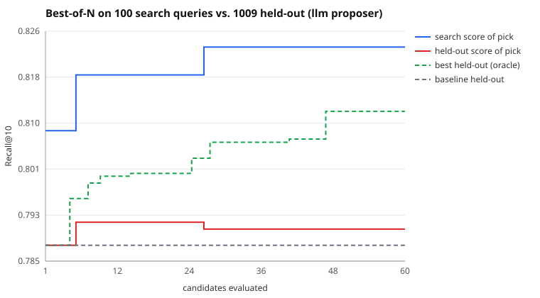

# Search run: llm proposer, 60 candidates

Search split: 100 queries. Held out: 1009 queries the search never saw. Seed 17.

| | search split | held out |
|---|---|---|
| Baseline BM25 | 0.8083 | 0.7878 |
| Picked (best on search) | 0.8233 | 0.7907 |
| Oracle (best on held-out) | 0.8083 | 0.8118 |

- **Claimed gain** (search split): +1.5 pts Recall@10
- **Real gain** (held out): +0.3 pts (95% CI -1.6 pts to +2.1 pts)
- **Gain inflation** (claimed minus real): +1.2 pts
- Optimism of the pick (its search score minus its held-out score): +3.3 pts
- Rank correlation of search vs held-out scores across candidates: 0.69
- Picked config: `{"b": 0.4, "k1": 0.9, "prf_docs": 1, "prf_terms": 5, "prf_weight": 0.4, "stem": true, "stopwords": true, "title_weight": 1.0}`

LLM proposer (qwen3:4b via LLMGate): 59 proposals, 59 gateway calls, 69,447 tokens (1177/proposal), 4 unparseable replies, 0 gateway errors, 6.7s mean latency.

