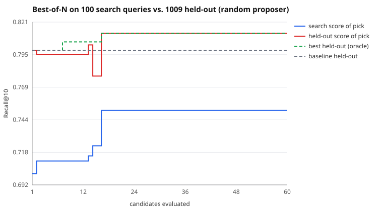

# Search run: random proposer, 60 candidates

Search split: 100 queries. Held out: 1009 queries the search never saw. Seed 11.

| | search split | held out |
|---|---|---|
| Baseline BM25 | 0.7010 | 0.7984 |
| Picked (best on search) | 0.7510 | 0.8119 |
| Oracle (best on held-out) | 0.7430 | 0.8120 |

- **Claimed gain** (search split): +5.0 pts Recall@10
- **Real gain** (held out): +1.3 pts (95% CI +0.0 pts to +2.7 pts)
- **Gain inflation** (claimed minus real): +3.7 pts
- Optimism of the pick (its search score minus its held-out score): -6.1 pts
- Rank correlation of search vs held-out scores across candidates: 0.85
- Picked config: `{"b": 0.94, "k1": 0.74, "prf_docs": 4, "prf_terms": 4, "prf_weight": 0.1, "stem": true, "stopwords": true, "title_weight": 0.44}`

