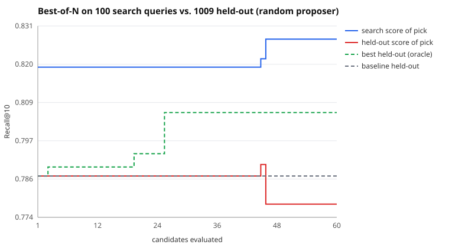

# Search run: random proposer, 60 candidates

Search split: 100 queries. Held out: 1009 queries the search never saw. Seed 13.

| | search split | held out |
|---|---|---|
| Baseline BM25 | 0.8192 | 0.7867 |
| Picked (best on search) | 0.8275 | 0.7784 |
| Oracle (best on held-out) | 0.7842 | 0.8056 |

- **Claimed gain** (search split): +0.8 pts Recall@10
- **Real gain** (held out): -0.8 pts (95% CI -2.6 pts to +0.8 pts)
- **Gain inflation** (claimed minus real): +1.7 pts
- Optimism of the pick (its search score minus its held-out score): +4.9 pts
- Rank correlation of search vs held-out scores across candidates: 0.68
- Picked config: `{"b": 0.57, "k1": 1.76, "prf_docs": 4, "prf_terms": 18, "prf_weight": 0.46, "stem": false, "stopwords": false, "title_weight": 1.35}`

