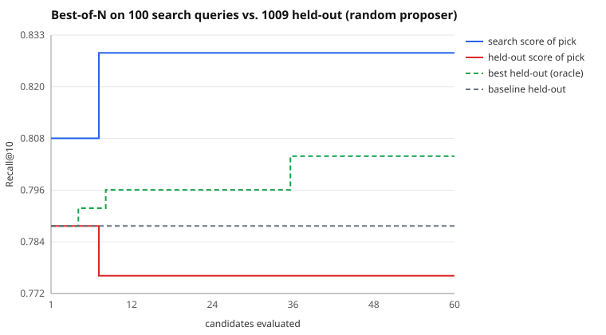

# Search run: random proposer, 60 candidates

Search split: 100 queries. Held out: 1009 queries the search never saw. Seed 17.

| | search split | held out |
|---|---|---|
| Baseline BM25 | 0.8083 | 0.7878 |
| Picked (best on search) | 0.8283 | 0.7761 |
| Oracle (best on held-out) | 0.8183 | 0.8041 |

- **Claimed gain** (search split): +2.0 pts Recall@10
- **Real gain** (held out): -1.2 pts (95% CI -2.6 pts to +0.2 pts)
- **Gain inflation** (claimed minus real): +3.2 pts
- Optimism of the pick (its search score minus its held-out score): +5.2 pts
- Rank correlation of search vs held-out scores across candidates: 0.81
- Picked config: `{"b": 0.12, "k1": 2.58, "prf_docs": 5, "prf_terms": 5, "prf_weight": 0.02, "stem": true, "stopwords": false, "title_weight": 0.51}`

