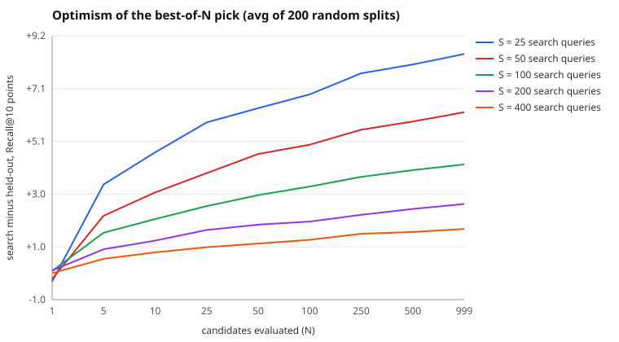

# Sweep: 1000 random configs, 200 random splits per size

## Optimism of the pick (search minus held-out Recall@10, points)

| search queries (S) | N=1 | N=5 | N=10 | N=25 | N=50 | N=100 | N=250 | N=500 | N=999 |
|---|---|---|---|---|---|---|---|---|---|
| 25 | -0.3 | +3.4 | +4.7 | +5.8 | +6.4 | +6.9 | +7.7 | +8.1 | +8.5 |
| 50 | -0.2 | +2.2 | +3.1 | +3.9 | +4.6 | +5.0 | +5.5 | +5.8 | +6.2 |
| 100 | +0.1 | +1.5 | +2.1 | +2.6 | +3.0 | +3.3 | +3.7 | +4.0 | +4.2 |
| 200 | +0.1 | +0.9 | +1.2 | +1.7 | +1.9 | +2.0 | +2.2 | +2.5 | +2.7 |
| 400 | -0.0 | +0.5 | +0.8 | +1.0 | +1.1 | +1.3 | +1.5 | +1.6 | +1.7 |

## False-win rate (search reports a gain; held-out shows none)

| search queries (S) | N=1 | N=5 | N=10 | N=25 | N=50 | N=100 | N=250 | N=500 | N=999 |
|---|---|---|---|---|---|---|---|---|---|
| 25 | 0% | 36% | 43% | 51% | 52% | 54% | 54% | 53% | 52% |
| 50 | 0% | 34% | 42% | 46% | 49% | 46% | 44% | 42% | 39% |
| 100 | 0% | 33% | 39% | 34% | 32% | 29% | 23% | 20% | 20% |
| 200 | 0% | 25% | 28% | 28% | 21% | 15% | 13% | 10% | 6% |
| 400 | 0% | 23% | 30% | 23% | 16% | 10% | 8% | 5% | 2% |

## Claimed vs real gain over baseline at N=999 (points)

| search queries (S) | claimed (search) | real (held out) |
|---|---|---|
| 25 | +8.3 | -0.5 |
| 50 | +6.7 | +0.3 |
| 100 | +5.0 | +0.9 |
| 200 | +3.9 | +1.3 |
| 400 | +3.3 | +1.6 |

